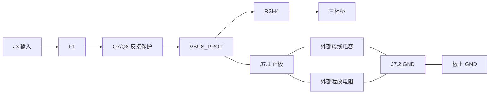

# AD7606C 外置 DC-link 改版与验证

## 后续 PWM ECO 提示

本报告及其 ZIP 对应本日 PWM 下拉优化之前的源。后续两工程 R56–R61 已改为 10 kΩ；[当前 PWM_SAFETY_GATE 审查](../../pwm_safety_gate_review_2026-10-20.md)记录新鲜验证和当前源摘要。此处保留外部 DC-link 的拓扑/计算历史，旧 ZIP 不能作为新阻值版的制造交付。

2026-10-20，分支 `fix/ad7606c-jlc-fabrication-review-20261020`。用户明确取消 dc-link 整页器件，改用外部母线电容和泄放电阻，只预留一个接口。本次仅修改 AD7606C 工程；ADS8588S 对照工程保持原电路。

## 已落实的电气与 PCB 变更

- 删除 `dc_link.kicad_sch` 及父页的该子页；取消 C1、C2、C120–C127、R120–R129，共 20 个器件，更新 BOM 和过期网类分配。
- 保留 J7，移至 `power_input.kicad_sch`，名称为 `EXT_DC_LINK`，MPN 仍为 Phoenix Contact 1714971。保留该实例及其物理引脚 UUID，更新原生 PCB 层次路径、值及用途字段。
- J7.1 接 `/VBUS_PROT`，J7.2 接 `/GND`，位于反接保护之后、RSH4 之前；外部支路不会绕过 RSH4 的桥电流检测。C3/C4 局部高频旁路保持原连接。
- 原生 PCB 删除对应 20 个封装和 20 个专属支路铜路对象，补铜并保存。其余走线/过孔、保留器件位置/角度/层/焊盘几何和网络、铺铜轮廓、原板框及安装孔保留；新增接口名称、正负极共 3 处丝印，原生 DRC 已核对。

电容和泄放电阻在外部并联，不进入本 PCB 的采购/装配 BOM。J7 没有被宣称为已验证的再生制动器。

## 外部组件与接线合同

以下是本改版的静态接口要求和参考泄放参数，不代表已经采购、装配或测量的外部组件。

| 条件 | 本版要求 |
| --- | --- |
| 输入与波形 | 24–48 V，20 kHz，10 Arms 连续相电流；20 A 瞬时正弦相电流幅值持续 30 s，非 20 Arms |
| 外部电容 | 标称 1000 µF；有效值至少 800 µF；本泄放计算使用最大 1200 µF；额定耐压至少 100 V |
| 电容纹波 | 在实际开关频率、温度和并联分配后可用额定纹波电流至少 11 Arms；不能相加未降额的宣传额定值 |
| 母线限制 | 板上母线含过冲不超过 60 V；100 V 电容不能提高 LM74502 等器件的允许母线电压 |
| 泄放参考 | 2.2 kΩ ±5%；按最高实际环境/安装条件降额后，电阻可用连续功率至少 3.5 W；不能仅凭“5 W”名义功率认定符合 |
| 计算结果 | 最大初始功耗 `60²/(2200×0.95)=1.72249 W`；最慢放电 `2200×1.05×1200µF×ln(60/5)=6.88816 s`，小于 10 s 目标 |
| 储能 | 1200 µF、60 V 上限对应 2.16 J；电阻须同时满足连续功耗、工作电压和接线故障条件 |
| 连接条件 | 短、紧耦合、低电感的正负线接 J7，外部电容和泄放支路在上电前接好，断电后保持连接直到确认母线低于 5 V；禁止热插拔 |
| 外部支路保护 | J7 在 F1 后，外部电容或其他源从 J7 回送的故障电流不受输入 F1 切断；外部支路须有独立协调的保险、限流和隔离/断开措施 |
| 再生 | 泄放参考在 48 V 仅消耗约 1 W，不能承担未限定的电机再生功率。电机操作前仍须验证电源吸能能力或独立外部钳位/吸能装置 |

J7 线缆/接头/接线端子的温升、故障电流和实际环路过冲仍须资格验证。增加容量、更改电阻或改变母线包络，需要重新计算放电时间、热和启动条件。泄放电阻是被动放电路径，不保证残压传感或失效安全；接触前须独立测量。

## 已执行验证与证据边界

新鲜 XML 为 **182 元件 / 162 网络 / 674 物理引脚归属**。与变更前 XML 逐项比较：恰好删除授权的 20 个引用，所有保留物理引脚的网名和归属精确不变；仅 J7 的名称/用途发生预期变化。原生 ERC、补铜 DRC、未连接和图板一致性已检查。原生对象比较证明没有新增电气铜路或改动保留铜路几何。

完整回归入口 **356 项，0 失败，44 跳过**；另在 pcbnew 解释器运行 **96 项 PCB 测试，全部通过**。44 项跳过不记作动态资格通过。新增外置网络规则拒绝遗留板载电容/阻尼器件、J7 接到反接保护前或分流器后、丢失 C3/C4、重复外部接口，以及不足的纹波/泄放预算或虚假资格声明。

制造复审使用 Gerbonara API 解析 Gerber/Excellon，避免旧版 CLI 缺少 `bounding-box` 子命令的问题；在实际 KiCad Python 进程提供 PDF/CAM 依赖，不忽略缺失依赖。铜层、mask/paste、丝印、板框、钻孔、BOM/CPL、图纸和 STEP 从同一源生成并哈希绑定。最终计数、来源摘要与运行结果见 [external_summary.json](external_summary.json)。

原生 F8 窗口控制在重试和重置后仍不可用；本次采用 KiCad pcbnew 对象接口进行限定删除/字段更新，再独立核对网表、图板 parity 和保留几何。未直接改写 PCB S-expression 以伪造 parity，也未新增排除或降低规则严重度。

## 放行状态

本次完成的是外置 DC-link 的 CAD 变更及静态/制造文件验证。**制造放行仍为 BLOCKED**：实际 JLC041621-3313 / Tg155 材料、四层 Type VII POFV、J1/J5 及 J4 指定成品孔公差的订单接受，以及源绑定的工程/装配审阅仍需关闭。PCB 动态 OCP、供电时序、热、外部储能/泄放/再生、实际 AX7010 接线和 RTL/STA 保持 NOT_RUN/OPEN；没有伪造人工签核、厂家接受、实物测试或下单。

本轮不更改 [发布门禁](../../release_gates.md)的这些限制。此前包含板载 DC-link 的制造包为历史资料，不可与本版交叉使用。

## 本版交付文件

随 Git 保留的复审核对资料：[输入页](evidence/schematic-02.png)、[PCB 图纸](evidence/drawing.png)、[逐引脚电气变更](evidence/electrical-transition.json)、[保留 PCB 几何核对](evidence/native-retained-geometry.json)、[厂家复审要求](evidence/JLC-review-notes.txt)及[指定成品孔](evidence/controlled-finished-holes.csv)。

- [最终制造复审包](../../../artifacts/ad7606c-external-dclink-20261020/ad7606c_external_dc_link_review.zip)：包含同源 Gerber、钻孔、BOM/CPL、图纸、STEP、原生检查及 SHA256 清单，仅供工程/厂家复审。
- [厂家复审要求](../../../artifacts/ad7606c-external-dclink-20261020/JLC-review-notes.txt)和[指定成品孔清单](../../../artifacts/ad7606c-external-dclink-20261020/controlled-finished-holes.csv)：独立随附，未装入 ZIP；须与该包一起提交工艺确认。

ZIP 的 SHA256 为 `79301da9642ac9216ef9b9907f6df6b3ab8fe80117e33c3a948a11a7c79f1a23`。文件位于本地忽略的 artifacts 目录，提交 Git 或传递报告时须另行保留并附带交付文件。
