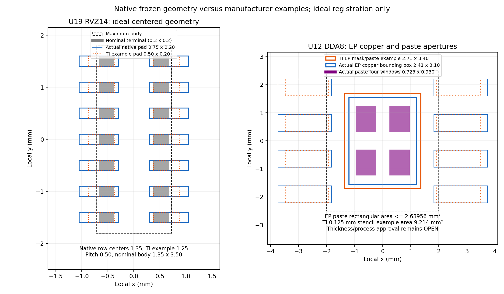

# C09 native footprint and assembly review — 2026-10-19

**Historical pre-ECO geometry review / fabrication blocked.** The dimensions called "current" below refer to the recorded pre-ECO candidates, not the adopted source boards. The subsequent assembly ECO installs U12 DDA0008B, U19 RVZ W025, D11 bank courtyards and J4 controlled 1.85 mm holes; see [exact ECO proof](assembly_land_eco_verification.json), [current adoption index](README.md) and [final exported CAM review](final_cam_review.md). Human assembly/process approval remains OPEN.

**Original baseline analysis:** Recommended lands are examples; differences alone do not prove an assembly defect. This review compares real native geometry with terminal limits and identifies the remaining assembly/process decisions. No hardware source was changed. Native inputs and SHA-256 are in `native_geometry.json`; extraction used KiCad's pcbnew interpreter and asserted inputs unchanged. Source filenames identify immutable ADS common-power-final and AD frozen-critical-0113 boards; later placement moves do not establish changed pad dimensions. Final footprints after any ECO require fresh extraction and whole-board courtyard/paste/DRC verification.

All dimensions below are mm. Native F.Fab and courtyard bounding boxes in JSON include graphic line width; use line **center geometry** for body/courtyard comparison. SMD signal pads in these candidates include F.Paste and F.Mask, effective expansion/margin zero unless specified. That is actual CAD geometry, not stencil/process approval.

| Exact component / native refs | OEM terminal/body/height limits | Actual native lands / hole / paste | Assessment and remaining work |
|---|---|---|---|
| TI AM26LV32EIPWR, U7 | PW0016A: body 4.3–4.5 ×4.9–5.1; total span6.2–6.6; lead width.17–.30, length.50–.75, pitch.65, height≤1.2. Terminal position tolerance.10 at MMC. | TSSOP16: pads1.475×.400, row centers5.725; inner/outer positive x2.125/3.600. Pad gap.250; paste1:1. TI example1.5×.45,row5.8. | Ideal lead-length envelope fully overlaps existing pads. Smaller pad width needs assembly tolerance qualification; neither logical parity nor package name gives that qualification. Generic land may be retained after process review; not claimed exact OEM. |
| TI TXU0204PWR, AD U27–29 | PW0014A: body4.3–4.5 ×4.9–5.1, span6.2–6.6; lead.17–.30 ×.50–.75, pitch.65,height≤1.2. | TSSOP14: same pad/row geometry as U7;14pads. TI example1.5×.45,row5.8, paste1:1. | Same ideal overlap and width-registration issue as U7. Dedicated TXU package drawing was used; this conclusion does not rely solely on a shared TSSOP name. |
| TI ADS8588SIPM, ADS U6 | PM0064A: body9.8–10.2 square; overall11.8–12.2; lead width.17–.27,length.45–.75,pitch.5,height≤1.6. Terminal position tolerance.08MMC. | LQFP64: pads1.55×.30,row centers11.35; positive x4.90..6.45; gap.20. OEM example1.5×.30,row11.4; paste1:1. | Existing pad length fully covers ideal lead envelope; width equals OEM example. Registration and paste printing remain process decisions. |
| ADI AD7606C-16BSTZ, AD U6 | ST-64-2: body9.8–10.2 square, span11.8–12.2; lead.17–.27,length.45–.75,pitch.5,height≤1.6. | Same actual LQFP64 native geometry as ADS. | Manufacturer outline agrees with geometric envelope. Exact ADI recommended board-land/stencil drawing was not obtained; retain OPEN rather than attributing TI's example to ADI. |
| TI TPD6E05U06RVZR, U19 | RVZ: body1.25–1.45 ×3.40–3.60; terminal.25–.35 length ×.15–.25 width,pitch.5,height.45–.55; no exposed thermal pad. | Pads.75×.20,row centers1.35; x+.30..1.05; paste1:1,gap.30. TI example.50×.20,row1.25; stencil.1 thick. | Native longer/outward pads have ideal minimum longitudinal terminal overlap.25. Width equals OEM example. No demonstrated intrinsic fit failure; exact position/assembly tolerances remain OPEN. See drawing and tolerance analysis below. |
| TI LM5164DDAR, U12 | DDA0008B: body3.8–4.0 ×4.8–5.0; span5.8–6.2; lead width.31–.51,length.40–1.27,pitch1.27,height≤1.7. Physical EP2.11–2.71 ×2.8–3.4. | Signal pads1.91×.61,row5.56; x+1.825..3.735; gap.66. Four touching EP pad9 rectangles total bounding2.41×3.10. Each paste aperture.723×.930 from native negative margins; total2.68956mm². | Signal terminals retain substantial contact; EP/paste process is unresolved. Native paste volume and EP coverage differ materially from the OEM example. Parent owns proposed new exact DDA footprint ECO and subsequent native import. |
| NCC EKZN101ELL101MJ20S, C1/C2/bank same MPN | Current KZN2026: nominalD10×L20; D'≤10.5,L'≤21.5; lead.6,pitch5±.5. | GenericCP_D10/P5: 2.0pad/1.0drill,pitch5; courtyard centerD10.5; no paste. | Bodymax reaches present courtyard boundary, leaving zero assembly margin at that limit. Parent/component audit found D11courtyard geometrically feasible at exact11bankpitch, pending native global courtyard check. Worst rigid pitch/normal-hole limits need controlled lead forming/insertion; do not call all tolerance corners drop-in. Polarity must be physically inspected. |
| Faratronic C212E105J6BC000, C3 | C21 small size 250V/1µF: W17.5,H12.9,T7.2 maximum; pitch15±.8; lead.60±.05; C000 straight leads. | Existing18×8body nominal, P15,2.4pads/1.2drill; courtyard18.5×8.5 center geometry; no paste. | Maximum body fits courtyard with .5/.65 side allowances if centered. Large lead-pitch tolerance requires documented forming/insertion rather than assuming rigid pin fit. Above-board height depends on seating; verify actual≥12.9body envelope and insulation/lead trimming. |
| KEFA KF950-9.5-3P, J4 | OEM drawing: P9.50±.03, recommended finishedPTH1.80+0.10/−0.00; contact1.30×.80, body width12.60, lengthP×9.5=28.5,height21.45; drawing general tolerances apply. | NativeP9.5,1.80drill,3.4pads; body12.6×28.5; courtyard13.6×29.5 center geometry; no paste. | Nominal PCB matches pitch/drawing. Standard JLC hole tolerance cannot guarantee OEM finished-hole interval; controlled process/nominal selection needed below. Maxbody13.1×29.0 at general±.5 leaves.25per side insidecourtyard. Torque, wire and terminal installation review remain separate. |
| Shiheng CMFA103F3950, NTC1/2 | Exact family/part: body1.6±.15 ×.8±.15,height.8±.15; terminallength.3±.2. Recommended A(gap).6–.8,B(padlength).6–.7,C(width).6–.8. | Localpads.65×.70,center±.675→gap.70; paste1:1; courtyard2.5×1.4 center geometry. | Gap/pad dimensions are within the recovered OEM ranges; bodymax1.75×.95 fits courtyard. Paste/thickness, solder process, exact received package and height still need assembly confirmation. |

## U19 / U12 contact and tolerance calculations

Ideal centered longitudinal contact is calculated from intervals, not from footprint names. On the positive row, U19 terminal outer edge is half the body width (.625..725), with terminal extending inward .25..35; the native pad occupies x=.30..1.05. Minimum contact across correlated body/lead limits is .25mm. Even ±.05mm translation along that axis retains ≥.25mm. The extra toe copper does not itself prove an unusable assembly. Native pad width.20 equals TI's example and can be narrower than the .25max terminal.

For U12, the native signal pad interval1.825..3.735 overlaps the ideal toe/lead envelope by at least .40mm. For maximum lead width.51, pad.61 provides .05mm/side at nominal centering. That is not a complete tolerance stack. Its EP copper bounding area7.471mm² is81.1% of the largest physicalEP rectangle9.214mm²; actual solder wetting/voiding is not proven by those rectangle areas.

The following is an **assumed ±.05mm total placement translation screening**, not an assembly-vendor capability claim. Rotation, solder self-alignment, board/stencil registration and inspection criteria must be specified before qualification. Terminal position tolerance at MMC is conservatively split as half the stated tolerance; bonus tolerance/shape are not credited. For width wPad,wLead and total transverse center error E, overlap is max(0,min(wPad,wLead,(wPad+wLead)/2−E)).

| Part | Conservative E (OEM terminal position + assumed placement) | Worst width overlap | Adjacent pad-to-terminal clearance |
|---|---:|---:|---:|
| U7 PW16 | .10/2+.05=.10 | .25,83.3% of maxlead.30 | .65−.20−.15−.10=.20 |
| ADS PM64 | .08/2+.05=.09 | .195,72.2% of maxlead.27 | .50−.15−.135−.09=.125 |
| U12 DDA8 | .25/2+.05=.175 | .385,75.5% of maxlead.51 | 1.27−.305−.255−.175=.535 |
| U19 RVZ14 | .05placement only; OEM position limit not given | .175,70% of maxlead.25 | .50−.10−.125−.05=.225 |

These positive overlaps are useful fit evidence, **not an IPC solder-joint acceptance standard**. U19's unknown terminal-position budget prevents a guaranteed minimum. Existing native copper pad gaps are respectively.25/.20/.66/.30; native mask expansion was zero. With a future positive mask expansion m, residual mask web is padGap−2m before mask-fabrication tolerance. Actual vendor registration/web limits remain unapproved.

The live JLC capability table was read on 2026-10-19: 1:1 pad/mask is offered; the 2oz soldermask-bridge minimum pad spacing is.20mm. Thus the ADC's native.20gap is exactly that nominal boundary, while U7/U12/U19 exceed it. The same table states a general minimum SMD pad.25×.25; U19's .20wide OEM-example pad therefore needs explicit manufacturer acceptance of that fine-pitch pattern. Do not expand it blindly because.5pitch/.25width changes mask and solder geometry. These catalog limits do not substitute for actual DFM acceptance of exported copper/mask/paste.

U12's substantive concern is the EP process. TI DDA0008B example EP mask opening2.71×3.4 and underlying metal2.95×4.9 may be adjusted for creepage. The example prints100% of exposed pad area, with stencil/apertures: .100→3.03×3.80; .125→2.71×3.40; .150→2.47×3.10; .175→2.29×2.87, approximately1.15mm³ paste volume each. Current four-window rectangle upper volume is .336195mm³ for a .125stencil,29.2% of that example. Four actual .30drill/.60diameter GND vias lie within U12EP at(60.7,11.5),(59.3,12.5),(59.3,11.5),(60.7,12.5). No filled-via process was proven. The OEM recommends filled, plugged or tented vias if beneath paste. New apertures must account for holes and approved stencil thickness; a rectangle-area ratio is not a thermal-joint qualification.

## Implemented assembly corrections — 2026-10-19

The preceding measurements describe the audited baseline. Both current schematic sources now select U12 `TI_DDA0008B_LM5164`, U19 `TI_RVZ0014A_W025`, bank capacitors `NCC_KZN_D10_P5_Courtyard11`, and J4 `KEFA_KF950_3_9.50mm_D1.85`. U12 has the OEM2.95×4.9mm EP metal and separate2.71×3.4mm mask/paste aperture for the proposed0.125mm stencil; U19 pad width is0.25mm with0.25mm gap; bank courtyard diameter11mm includes the10.5mm maximum can plus0.25mm assembly clearance per side. J4 nominal finished hole is1.85mm, still requiring the controlled±0.05mm ENIG process. The U19 wider land is an explicitly reviewed assembly adaptation, not a claim of copying the OEM0.20mm example.

[Exact native source proof](assembly_land_eco_verification.json) records unchanged net names, physical memberships and component identities, with only13 footprint IDs and C133 soft-start budget metadata changed. Both native ERC runs are0/0/0. Integrated PCB candidates also move U12's four thermal vias outside the new central mask/paste aperture and remove the historical broad footprint clearance override. Source-board adoption is recorded in the current adoption index. Fresh actual Gerber aperture unions are recorded separately in the final CAM review; its hash and project determine applicability. Solder joint qualification and supplier process acceptance remain pending. These changes close identified CAD land defects; they do not approve the complete manufacturing process.

## Controlled through-hole process and forming

For J4, OEM finished diameter interval is[1.80,1.90]. A regular +.13/−.08 process requires nominal n≥1.88 and n≤1.77 simultaneously: **empty interval**. A controlled ±.05 process requires n=1.85, giving[1.80,1.90]. Alternatively retain native n=1.80 only with an explicitly accepted +.10/−.00 finished-hole process. The advertised JLC special±.05 process is conditional on multilayer ENIG and written order identification; no supplier acceptance is claimed. Current n=1.80 with regular process would yield[1.72,1.93]. Existing pad3.4 around nominal1.8 has.8radial copper before fabrication tolerances.

The same arithmetic must use J1/J5's **own** OEM interval, not J4's. Parent's JILN interval.97..1.07 with controlled±.05 yields nominal1.02. These are distinct controlled-hole notes.

For C1, assuming a rigid .60lead and regular1.00drill gives minimum hole.92 and radial play.16; with pitch tolerance±.5, splitting the pitch mismatch evenly can require.25/lead. For C3, minimum hole1.12/maxlead.65 gives.235radial play, while pitch±.8 can require.40/lead. Flexible leads can be formed; this is a missing assembly forming procedure, not evidence that those capacitors cannot be fitted. C1 lead diameter tolerance was not specified by this family sheet and must be confirmed for the received part. Finished-hole control, lead forming, plating annulus, insertion force and body seating must be verified together.

## Primary evidence and reproducibility

`oem_download_manifest.json` / `extra_oem_manifest.json` include retrieved URLs, byte counts and SHA-256. Manufacturer-authored drawings hosted by LCSC are identified as mirrors, not LCSC-authored dimensions. Locally rendered pages were actually viewed, including raster-only RVZ pages22/23 and Faratronic small-body dimensions.

- [TI AM26LV32E](https://www.ti.com/lit/ds/symlink/am26lv32e.pdf), PW0016A pp25–27.
- [TI TXU0204](https://www.ti.com/lit/ds/symlink/txu0204.pdf), PW0014A pp41–43.
- [TI ADS8588S](https://www.ti.com/lit/ds/symlink/ads8588s.pdf), PM0064A pp59–61.
- [ADI AD7606C-16](https://www.analog.com/media/en/technical-documentation/data-sheets/ad7606c-16.pdf), ST-64-2 p80.
- [TI TPD6E05U06](https://www.ti.com/lit/ds/symlink/tpd6e05u06.pdf), RVZ outline/land pp22–23; the mechanical drawings are raster images and text search alone missed them.
- [TI LM5164](https://www.ti.com/lit/ds/symlink/lm5164.pdf), February2026 DDA0008B pp28–30.
- [NCC KZN2026](https://www.chemi-con.co.jp/products/relatedfiles/capacitor/catalog/KZNLL-e.PDF), pp1/3.
- [Faratronic C21 manufacturer drawing mirror](https://atta.szlcsc.com/upload/public/pdf/source/20190717/C404859_EF21AC612EDD98432EE9D266CBC8B364.pdf), pp1–3; exact MPN crosswalk inherited from `docs/sourcing/selected_overrides_2026-10-10.json` and rechecked against drawing codes.
- [Shiheng CMFA manufacturer drawing mirror](https://atta.szlcsc.com/upload/public/pdf/source/20210906/B03A8E165737D41272F439C17FAA3AAF.pdf), p2.
- [KEFA KF950 manufacturer drawing mirror](https://atta.szlcsc.com/upload/public/pdf/source/20230317/5CF0E53AE61B49AED08041D18ECB4E9D.pdf), p1.
- [JLC published capability table](https://jlcpcb.com/capabilities/pcb-capabilities), regular and special circular finished-hole tolerance. Actual order capability is pending written confirmation.

Run `python artifacts/dual-servo/footprint-qa/extract_native_geometry.py` with KiCad's Python for extraction; run `python artifacts/dual-servo/footprint-qa/draw_land_comparison.py` with the normal project Python for the dimension figure. Reproduction must retain the source-hash distinction if later candidates change. No physical sample, solder inspection, stencil qualification or manufacturing approval was executed.
