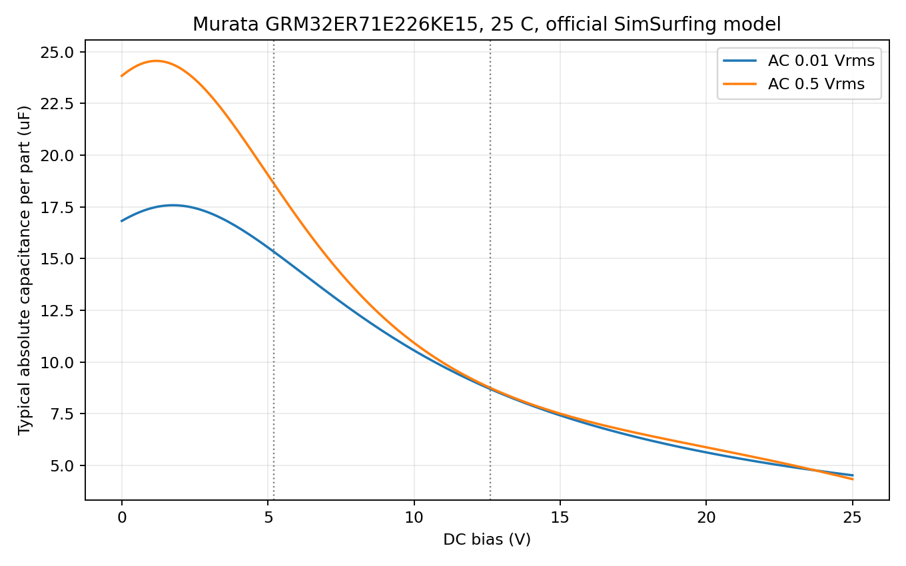

# TPS62901 local capacitance review — 2026-10-19

**Engineering selection supported; hardware qualification OPEN.** The parent adopted the schematic ECO after native pin-graph/ERC review; see [controlled proof](5v_eco_verification.json). PCB integration remains in progress. C30: one GRM32ER71E226KE15L; C31+C132: two of the same part; C133: 10 nF soft-start capacitor. Exact supplier identity was checked directly: [LCSC C21397](https://www.lcsc.com/product-detail/C21397.html), Murata GRM32ER71E226KE15L, 22 µF ±10%, 25 V, X7R, 1210. Procurement must recheck lifecycle and authorized stock before ordering.

## Actual combined model, not independent curve multiplication

The current public [Murata SimSurfing](https://ds.murata.com/simsurfing/mlcc.html) frontend was inspected and its exact-part characterization request reproduced by `fetch_murata_bias.py`. `murata-bias-download.json` records full public query URLs and response SHA-256. Raw responses include both valid curves and explicit errors for unsupported AC choices (0.05 and 0.1 Vrms); those errors were excluded. `cap_bias_budget.json` and `summarize_cap_bias.py` preserve the numerical calculation. All are typical manufacturer models, **not guaranteed minimum capacitance**.

| GRM32ER71E226KE15, 25°C | AC 0.01 Vrms | AC 0.5 Vrms |
|---|---:|---:|
| Absolute C at 0 V | 16.819736 µF | 23.830333 µF |
| Absolute C at 5.2 V | 15.332944 µF | 18.629187 µF |
| Absolute C at 12.6 V | 8.701699 µF | 8.756857 µF |

Values at 5.2/12.6 V use linear interpolation between returned model samples. The relative DC curves normalize to their own AC-dependent C at zero bias. Multiplying nominal capacitance by that relative DC curve and an unrelated AC curve would misrepresent the combined model.

Additional engineering reserves: tolerance 0.9 × temperature 0.85 × aging 0.9 = 0.6885. These deliberately independent reserves on the **absolute combined model** are assumptions, not a manufacturer statistical limit. They yield C30 ≥5.991120 µF budget at 12.6 V and C31+C132 ≥21.113464 µF budget at 5.2 V. Relative to the required 3/10 µF, budget margins are approximately 99.7% /111.1%. The 10 mVrms model is not a proof for arbitrarily smaller ripple or all operating temperatures.

## Converter and assembly constraints

[TI TPS62901 datasheet](https://www.ti.com/lit/ds/symlink/tps62901.pdf), locally `../oem-lands/ti-tps62901.pdf`, p4 specifies effective Cin ≥3 µF and Cout ≥10 µF for 2.5 MHz. Table 7-3 p18 allows 2.2 µH with 47 µF nominal; its 100 µF entry requires ESR ≥10 mΩ. Proposed 44 µF nominal fits the 47 µF region rather than the two-47 µF/94 µF option. This does not replace loop/load-transient validation or the whole connected rail's capacitance inventory. TI p21 recommends soft-start ≥1 ms. With 10 nF, tolerance 0.9 × temperature reserve 0.85 × aging reserve 0.9 × DC-bias reserve 0.9: Css ≥6.1965 nF engineering budget; ISS ≤2.7 µA; conservatively assumed Vref ≥0.78 V and K ≤700 µs: Tss ≥1.0901 ms. This supersedes the initial 1.51 ms calculation that omitted aging and bias reserves. The 0.9 low-bias factor for a 100 V capacitor at approximately 0.8 V is an engineering assumption, not an exact-part guaranteed minimum. K bound is deliberately the full displayed graph's upper bound; exact ramp must be measured. The resulting 90.1 µs margin is small, so final component and ramp qualification remain OPEN.

The actual Murata GRM32 reflow diagram (`../oem-lands/murata-1210-lands.png`, JEMCGC-2701X p25) defines **a as inner pad gap**, b as each pad length along the capacitor axis, c as pad width. Allowed: a=2.0–2.4 mm, b=1.0–1.2 mm, c=1.8–2.3 mm. A centered initial pattern a=2.2,b=1.1,c=2.05 means pad centers ±1.65 mm and pads 1.1×2.05 mm. Final footprint must be checked from native CAD against those dimensions. Package maximum body 3.5×2.7 mm, height 2.7 mm; courtyard must include body tolerance and assembly clearance. Paste/stencil thickness, aperture coverage and process approval remain OPEN; a 1:1 initial aperture is not an OEM stencil approval.

Before first power: confirm fitted exact MPNs, measure effective capacitance with actual bias/temperature, inspect solder/clearance, verify soft-start/inrush and regulator stability/load transients. No safety, DFM, fabrication, thermal or physical validation gate is claimed PASS here.

The complete native VA5 capacitor population is also included in each `aux_power_profile.json`: ADS adds4.5uF beyond the local44uF; AD adds11.3uF. With local caps +10% tolerance/+15%temperature and all other caps conservatively +20%/+15%, unbiased upper inventories are61.870uF /71.254uF. No DC-bias reduction is credited to this upper inventory; both remain below the100uF low-ESR boundary. Fresh XML rejects unreviewed parallel-capacitor additions. These population bounds do not replace a distributed-rail impedance/load-transient measurement.
