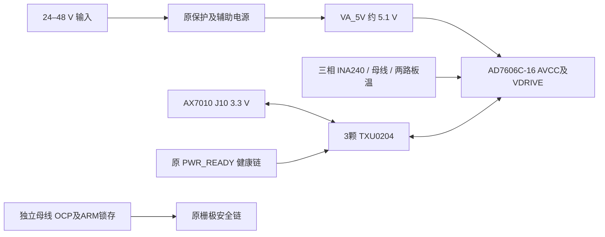

# AD7606C-16 + AX7010 开发板方案

2026-10-20 后续 PWM ECO：保留独立硬件关断门控并更名 PWM_SAFETY_GATE，R56–R61 改为 10 kΩ；运行/清除接口不变。受控周期边界恢复为待实现、待测要求；当前验证及旧制造包失效边界见 [门控审查](../../docs/pwm_safety_gate_review_2026-10-20.md)。

本方案是原伺服板的独立高速 ADC 版本，保留 24–48 V 母线、三相 INA240A1DR、5 mΩ 分流器、母线硬件 OCP、DRV8300 和 ABZ 编码器接口。ADS8588S 原工程继续作为对照。当前四层 PCB 已布线；2026-10-20 按用户确认取消板载 DC-link 电容/阻尼页，J7 保留为外部电容与泄放电阻接口，原生 ERC/DRC/未连接/图板差异均为 0。样机资格尚未开始；本版条件和证据见 [外置 DC-link 改版](../../docs/reviews/ad7606c_jlc_2026-10-20/external_dc_link.md)。

## 连接和供电

12 V 辅助电源按用户确认的**总连续负载 1 A**设计；包括门驱及 5.1 V 下游折算输入。L1、精密反馈和纹波网络 ECO、误差预算、测试边界见 [1 A 电源审查](evidence/aux_power_review_2026-10-18.md)。

ADC 的 VDRIVE 不从 J10 取电。AVCC/VDRIVE 同接 VA_5V，避免 FPGA 单独供电时违反 `VDRIVE <= AVCC+0.3 V`。TXU 的 A 电源为 VIO_3V3，B 电源为 VA_5V，所有 ADC 数字线均经过固定方向转换。OE 随 `PWR_READY`；TI 的断电隔离/Ioff 功能处理缺失电源域，实际慢斜坡、快速断电、残压及线缆过冲仍需测量。[ADI Table6](https://www.analog.com/media/en/technical-documentation/data-sheets/ad7606c-16.pdf)、[TI §9.3/11](https://www.ti.com/lit/ds/symlink/txu0204.pdf)。

这只修复 ADC 接口的供电关系。原伺服电路的其他独立供电/部分上电行为仍受原发布门禁约束；不能据此宣布整板任意上电顺序安全。TXU 为共地电平转换器，不提供隔离耐压。

| J10/J1 针 | FPGA 球脚 | 功能 | 板上路径 |
|---|---|---|---|
| 11 | Y14 | CONVST | U27 A1→B1Y→U6.9 |
| 12 | W14 | SCLK | U28 A1→B1Y→R104→U6.12 |
| 13 | P18 | CS_N | U28 A2→B2Y→U6.13 |
| 14 | N17 | RESET | U27 A2→B2Y→U6.11 |
| 15 | U15 | DOUTA | U6.24→U27 B3→A3Y→R100 |
| 16 | U14 | DOUTB | U6.25→U27 B4→A4Y→R101 |
| 17 | P16 | BUSY | U6.14→U29 B3→A3Y |
| 18 | P15 | FRSTDATA | U6.15→U29 B4→A4Y |
| 29 | U12 | DOUTC | U6.27→U28 B3→A3Y→R102 |
| 30 | T12 | DOUTD | U6.28→U28 B4→A4Y→R103 |
| 31 | T10 | SDI | U29 A1→B1Y→U6.29 |

J10.1/37/38 为 GND，39/40 为 VIO_3V3；2 的 +5 V 保持 NC。只使用已约定的 AX7010 2022/J10；仍需对实际板卡和线缆逐针导通确认。TXU 的一个多余 A→B 通道输入接地、输出留空；PW 封装 NC6/9 保持 NC。

## 输入和配置

| 通道 | 输入 | 软件量程 | 带宽 | 四路帧位置 |
|---|---|---|---|---|
| 1 / 2 | IU / IV | 0–5 V | 高 | DOUTA 前/后16位 |
| 3 / 4 | IW / VBUS | 0–5 V / 0–10 V | 高 | DOUTB 前/后16位 |
| 5 / 6 | 两路板载 NTC | 0–10 V | 低 | DOUTC 前/后16位 |
| 7 / 8 | 接地 | 0–10 V | 低 | DOUTD 前/后16位 |

全部 Vx− 接 GND。数据是 straight binary；电流换算用实测零点/增益，不能沿用旧双极性符号转换。5.1 V 中点约 2.55 V，在 0–5 V 量程中并非恰好半码。两个 NTC 都是板温，未提供远端电机绕组测温。

现有相电流 RC 47 Ω/1 nF 留作第一轮对照，截止约 3.39 MHz，不构成有效 PWM 抗混叠滤波。后续可评估约 100–300 kHz 的 RC 候选，但必须同时验证 INA240 输出恢复、额外延迟、噪声、增益和 PWM 采样窗口；本轮未将未测的候选值写成定版 BOM。

配置镜像在 `adc_profile.json`：02=10，03=55，04=65，05=66，06=66，07=0F，08=00（均十六进制）。硬连 OS=111 只进入软件模式，不能自动完成这些配置；32 个 SCLK/帧是在 CRC/status 关闭、四路输出已正确配置时的帧长。

## 启动与驱动实现合同

1. 固件配置前使 GATE_EN、FAULT_CLEAR 和六路 PWM 保持低；ADC 未就绪时不得发起 re-arm。确认真实地线、VA_5V/VIO、电源限流及原保护门禁，不连接电机进行初始采集调试。
2. 等待健康链及 `PWR_READY`。OE 低时 ADC 端 RESET/CS 上拉到 VA_5V，其余控制下拉。R110/R111 在 3.3 V A 端上拉 RESET/CS，克服 TXU 内部弱下拉，使 OE 高且 FPGA 高阻时也保持二者为高。FPGA 配置后必须主动执行完整复位，不能依赖电阻取代时序。
3. 按 ADI Rev.A Table3，电源稳定后至少 10 ms 才发起首次 RESET，RESET 高至少 3.2 µs。完整复位后等待不少于 274 µs；首次上电还必须满足该表脚注3的 `tPOWER-UP + tDEVICE_SETUP > 2 s`。开发起步采用首次完整复位释放后等待 2.1 s，再访问并核对配置。该保守等待并非已实现的 RTL。
4. 读设备 ID/状态，写配置并逐项读回，返回 ADC 读取模式；任何 ID、读回、复位检测或帧状态异常，继续保持 GATE_EN=0。欠压/失帧后重新验证配置和新样本，不复用旧缓存作为有效电流。
5. 从 5 MHz SCLK 和低速重复采样开始，四路同时接收 32 位，按照上述顺序重排成 8×16 位。记录 CONVST 时标、BUSY、FRSTDATA、帧有效与超时。寄存器读写协议和状态/CRC模式需要独立 HDL 仿真。
6. 验证静态输入、斜坡、正弦、每路增益/零点后，再审核低能量 PWM 试验。没有动态 OCP/供电证据之前，不进入额定功率或闭环带宽验收。

## 时序与布局工作

初始 5 MHz 下读帧 6.4 µs，20 MHz 目标下为 1.6 µs；芯片额定采样率不等于本接口配置已经实现的有效帧率。20 MHz 的半周期只有 25 ns，必须计算 SCLK 经 A→B、ADC 数据访问、DOUT 经 B→A、线缆和 FPGA 捕获建立/保持的整个往返预算；不能仅使用 ADI 最大 SCLK 或 TXU 标称数据率。必要时调整接收相位或降低 SCLK。XDC 当前只有引脚和 LVCMOS33，不包含伪造的已闭合 I/O delay/STA。

ADC 内部模拟相位延迟、输入 RC、INA240/PWM恢复、转换/读取、同步和 PWM shadow-load 调度应在同一个模型中分析，并通过时间戳/示波器验证，避免把不同定义的延迟重复相加。20 kHz PWM 与 3–5 kHz 闭环目标之间的稳定裕量仍未验证。

当前四层 PCB 已从本工程新网表建立，未继承旧板的布线或完成状态。建议先评审四层连续参考平面、模拟/数字分区和功率回流；铜厚、层叠和电流能力由制造商及热验证确定。C60/61/62/63 和四 AVCC 旁路必须贴近 U6 相应引脚；TXU 两电源各自有 100 nF，R100–103 靠 A 输出、R104 靠 U28 B1Y。数字信号不穿过参考/电流前端区，保留 Kelvin 与硬件故障链的短路径。

量产/打样前还需封装焊盘机械复核、新 PCB 与原理图一致性、全严重度 DRC/未连接闭合、DFM、BOM 采购核价，以及原 [发布门禁](../../docs/release_gates.md) 的母线再生、OCP 延迟、分流器/连接器热和电源资格。新 TXU 的 LCSC 编码/报价未确认，BOM 明示 UNVERIFIED；不据旧库存快照计算整板现价。
